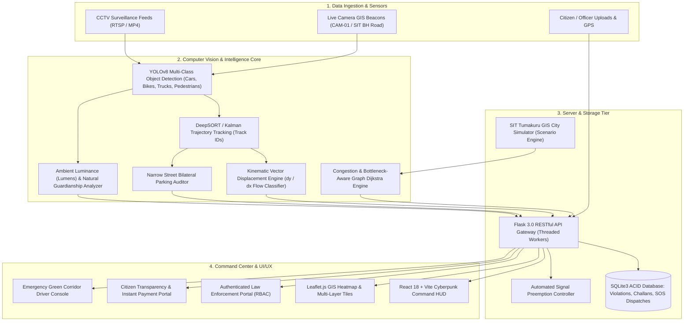

# RoadPulseAI — Hackathon Presentation & Pitch Deck
**Domain:** Smart City & Mobility  
**Problem Statement:** Smart Traffic & Road Management  
**Project Name:** RoadPulseAI (Autonomous Traffic Intelligence & Law Enforcement Ecosystem)  
**Target Deployment:** Tumakuru Smart City (S.I.T. Corridor & Surrounding Urban Arterials)  
**Downloadable Presentation (.pptx):** [RoadPulseAI_Smart_Traffic_Presentation.pptx](file:///Users/monika/Desktop/CIT1/RoadPulseAI_Smart_Traffic_Presentation.pptx)

---

## 📑 Slide Deck Outline & Transcripts

### Slide 1: Title Slide
- **Header:** Hackathon Evaluation 2026 • Smart City & Mobility
- **Project Title:** **RoadPulseAI**
- **Subtitle:** Autonomous Smart Traffic Vision, Law Enforcement & Emergency Mobility Ecosystem
- **Key Modules:** Real-Time Computer Vision • Autonomous E-Challan • Bilateral Parking Auditor • Emergency Green Corridors • Women SafeWalk AI
- **Domain Name:** Smart City & Mobility
- **Problem Statement Name:** Smart Traffic & Road Management
- **Speaker Pitch (30s):**
  > *"Good morning, esteemed judges. We are presenting RoadPulseAI, an autonomous smart traffic intelligence and law enforcement ecosystem built for the Smart City & Mobility domain, addressing the Smart Traffic & Road Management challenge. Instead of passive monitoring, RoadPulseAI creates an active, closed-loop urban intelligence network that automates wrong-way and illegal parking enforcement, clears life-saving green corridors for ambulances, and guarantees women commuter safety through computer vision and proactive police dispatch."*

---

### Slide 2: The Problem Landscape
- **1. Manual Policing Inefficiencies & Dangers:**
  - Human traffic officers cannot monitor multi-lane arterial corridors 24/7.
  - Stopping wrong-way violators on high-speed expressways puts police officers' lives at risk.
  - Manual paper challans suffer from bribery, human error, and massive revenue leakage.
- **2. Narrow Street Parking Gridlock:**
  - Tier-2 smart cities like Tumakuru face severe bilateral (both-side) parking in narrow lanes.
  - Carriageway widths drop below 3.5m, completely blocking two-way transit and emergency response vehicles.
- **3. Fatal Emergency Transit Delays & Women Safety Gaps:**
  - Ambulances lose critical golden-hour minutes stuck at uncoordinated traffic signals and intersection bottlenecks.
  - Women commuters navigating urban alleys after dark face heightened vulnerability due to lack of dynamic surveillance and street lighting deadzones.

---

### Slide 3: Proposed Solution — RoadPulseAI Ecosystem
RoadPulseAI solves these four challenges through an integrated 6-pillar software suite:
1. **Edge Computer Vision Surveillance & Tripwire Counting:** YOLOv8 + DeepSORT vector displacement engine detecting vehicles and bi-directional flows across configurable tripwires.
2. **Autonomous Wrong-Way Enforcement & E-Challan:** Instant photographic snapshot capture with license plate cropping, ₹2,000 fine calculation, and SQLite database logging.
3. **Narrow Street Bilateral Parking Auditor:** Automated legality compliance checking (Left vs. Right curb) and carriageway blockage detection with 1-click batch challan dispatch.
4. **Women Solo Travel Safety & SafeWalk AI:** Perceives ambient lighting in lumens and pedestrian density to score street safety (0-100%) with an interactive screen-centered Pink Patrol SOS emergency dispatch (siren + 3-minute ETA countdown).
5. **Emergency Green Vehicle Corridor & Signal Preemption:** Dedicated routing for Ambulances and Fire Engines with automated traffic light green-wave overrides and transparent AI reasoning based on live congestion and bottlenecks.
6. **Dual Transparency Portals:** Authenticated Police Officer Portal (RBAC login) and public Citizen Portal for evidence lookup and digital fine settlement.

---

### Slide 4: System Architecture Diagram

---

### Slide 5: AI & Computer Vision Models Used

| Model / Algorithm | Purpose | Key Technical Specifications |
| :--- | :--- | :--- |
| **YOLOv8 (Ultralytics)** | Multi-Class Vehicle & Pedestrian Detection | Single-stage CNN, 30+ FPS inference, confidence threshold $\ge 0.50$, bounding box regression $[x_1, y_1, x_2, y_2]$ |
| **DeepSORT & Kalman Filter** | Multi-Object Tracking across Occlusions | State space $[x, y, v_x, v_y]$, cosine metric appearance embedding, unique vehicle track persistence |
| **Displacement Vector Math** | Kinematic Flow & Wrong-Way Classification | Evaluates $\Delta y = y_t - y_{t-k}$ against expected road flow vectors; flags reverse motion as violation |
| **Dark Channel Prior & Grayscale Histogram** | Ambient Lighting Perception | Measures mean luminance (15 - 100 lumens) and dark shadow ratio to quantify urban street illumination |
| **Dynamic Heuristic Dijkstra** | Green Wave Emergency Routing | Minimizes transit impedance: $Cost = (\frac{Length}{Speed_{emg}}) \times LaneMultiplier + BottleneckPenalty$ |

---

### Slide 6: Complete Technology Stack

- **Frontend Application:**
  - React 18 (Component-driven SPA architecture)
  - Vite (Ultra-fast modern module bundler)
  - Vanilla CSS 3 Design System (Glassmorphic dark-cyber HUD, custom neon tokens)
  - Leaflet.js & Leaflet-Heat (Zero API key dependency, open-source GIS mapping)
  - Esri World Dark Gray Canvas, OpenStreetMap, and World Imagery Satellite tiles
  - Web Audio API (Synthesized acoustic radar alerts, police sirens, and preemption chimes)
- **Backend Architecture:**
  - Python 3.9+
  - Flask 3.0 (Threaded asynchronous request handling)
  - Gunicorn / Werkzeug WSGI server
  - Multipart/x-mixed-replace live JPEG frame streamer
  - CORS-enabled REST endpoints
- **Database & Persistence:**
  - SQLite3 with parameterized queries and index optimization
  - Tables: `violations`, `echallans`, `officers`, `sos_dispatches`, `camera_locations`
- **Computer Vision & Math Libraries:**
  - OpenCV (`cv2`), NumPy, PyTorch / Torchvision, Pillow (PIL)
- **DevOps & Quality Assurance:**
  - Docker container ready, GitHub Actions CI/CD workflows, PyTest test suite

---

### Slide 7: Feature 1 — Live Video Surveillance & Autonomous E-Challan
- **Virtual Tripwire:** Bidirectional tripwire counting vehicles passing IN and OUT across lanes.
- **Wrong-Way Movement Detection:** Instant tracking of displacement vectors. Vehicles travelling against traffic trigger an automatic alert.
- **Evidence Snapshot:** Automatically extracts high-resolution bounding box crop, watermarks timestamp and GPS coordinates, and assigns unique Challan ID.
- **Radar & Audio Ping:** Synthesizes audio warning and adds violation card to the live feed.
- **Local Count Reset:** Responsive zeroing button with instant neon emerald visual confirmation.

---

### Slide 8: Feature 2 — Narrow Street Bilateral Parking Auditor
- **Bilateral Curb Legality:** Solves single-lane gridlock by checking which curb side is parked (Left Legal vs Right Prohibited based on municipal rules).
- **Carriageway Clearance:** Calculates remaining road width between parked cars; alerts if carriageway width drops below emergency transit threshold (3.5m).
- **Batch Enforcement:** 1-click `Dispatch Wrong-Sided Vehicles` button issues official E-Challans to all violating parked cars automatically.

---

### Slide 9: Feature 3 — Women Solo Travel Safety AI & Pink Patrol
- **Dynamic Street Risk Engine:** Recalculates safety for Tumakuru streets based on:
  - Pedestrian Density (Optimal natural guardianship vs solitary isolation).
  - Ambient Lighting (High-mast LEDs vs unlit blackout deadzones).
  - Traffic Flow (Active passing transit vs deserted roadways).
- **SafeWalk Risk Rating:** Categorizes streets into *Low Risk (Safe)*, *Moderate Risk*, and *Critical Risk*.
- **Screen-Centered Emergency SOS Modal:**
  - Synthesized police siren sound.
  - Live 3-minute countdown ticker.
  - Assigned patrol vehicle unit details (e.g. *Tumakuru Pink Patrol Unit #02 / KA-06-G-1102*).
- **SafeWalk Route Auditor:** Compares direct dark shortcut alleys against AI SafeLit routes with monitored police booths and CCTV checkpoints.

---

### Slide 10: Feature 4 — Emergency Green Vehicle Corridor Engine
- **Dedicated Endpoint:** `/api/emergency/corridor` for Ambulances, Fire Engines, Police Escorts, and Organ Transports.
- **Dual Route Planning:**
  - **Primary AI Green Corridor (Solid Emerald):** Fastest transit utilizing multi-lane wide arterials with synchronized signal preemption.
  - **Alternative Contingency Route (Cyan Dashed):** Backup bypass if primary highway is blocked by a collision.
- **Explainable AI (XAI) Reasons:**
  - Explains travel time savings (e.g., *5.4 mins vs 7.6 mins normal, saving 2.2 mins / 29% faster*).
  - Analyzes multi-lane overtaking feasibility vs narrow choke points.
  - Identifies bypassed bottlenecks (e.g., *Avoids Town Hall Circle 72% congestion*).
- **Automated Signal Preemption:** Locks forward traffic lights to green with a 60-second clearance countdown window.

---

### Slide 11: Feature 5 — Officer & Citizen Governance Portals
- **Officer Enforcement Portal (`/officer`):**
  - Authenticated RBAC gate with police credentials (`officer`, `inspector`, `admin`).
  - Evidence review deck: inspect vehicle snapshot, license plate, and infraction type.
  - Workflow buttons: `Approve Violation` or `Dismiss / False Positive`.
  - Real-time revenue analytics and fine collection metrics.
- **Citizen Transparency Portal (`/citizen`):**
  - Public lookup by Vehicle License Plate or Challan ID.
  - Full photographic proof displayed to eliminate unfair penalties.
  - Integrated 1-click digital fine payment gateway.
  - Official municipal digital receipt generator with transaction reference.

---

### Slide 12: GIS Traffic Heatmap & Predictive Simulator
- **Dynamic Leaflet GIS Heatmap:** Visualizes live congestion hotspots across Tumakuru junctions (J1 to J8).
- **Predictive Traffic Forecasts:** 15-minute, 30-minute, and 60-minute future congestion advisories.
- **Interactive Scenario Simulation:** Allows city commissioners to simulate *College Rush*, *Heavy Monsoon Rain*, and *Festival Crowds* for disaster preparedness drills.

---

### Slide 13: Business Impact & Hackathon Winning Advantages
1. **Measurable Real-World Impact:**
   - Saves life-critical golden-hour minutes (30-50% faster emergency response).
   - Eliminates physical danger for traffic officers.
   - Restores carriageway access in congested narrow streets.
   - Protects solo women commuters with proactive surveillance and rapid SOS response.
2. **Cost-Effective & Scalable:**
   - 100% software and edge-AI based: works with existing CCTV feeds with zero costly road sensor installations.
   - Zero API key dependencies (open-source GIS and neural inference).
3. **Complete End-to-End Execution:**
   - Fully working live full-stack system with camera streaming, AI inference, relational database, and interactive frontend.

---

### Slide 14: Future Scope & Roadmap
1. **Automated Number Plate Recognition (ANPR):** OCR models fine-tuned on Indian High-Security Registration Plates (HSRP).
2. **Vahan & Sarathi Integration:** Direct API dispatch of SMS / WhatsApp challans to registered vehicle owners.
3. **Aerial Drone Video Ingestion:** Rapid deployment of camera drones for highway accident triage.
4. **V2X Green Wave Broadcasts:** In-vehicle HUD speed guidance for emergency drivers.
