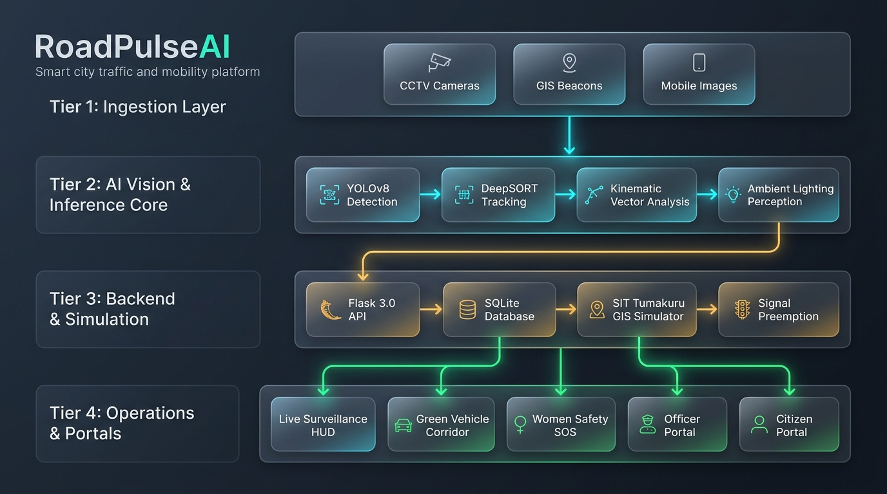
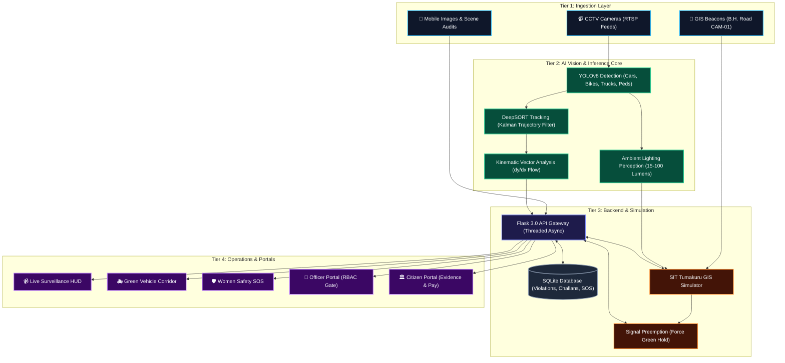

# 🏛️ RoadPulseAI — Complete System Architecture

**Domain:** Smart City & Mobility  
**Problem Statement:** Smart Traffic & Road Management  
**Target Deployment:** Tumakuru Smart City  

---

## 🖼️ System Architecture Diagram

---

## 📊 High-Level Flowchart (Mermaid)

---

## 🔬 Four-Tier Architectural Hierarchy

### 1. Ingestion Layer (Tier 1)
- **CCTV Surveillance Feeds:** Streams video at up to 30 FPS via OpenCV and RTSP network buffers.
- **Dynamic GIS Beacons:** Integrates real camera video coordinates (`13.3276, 77.1259`) directly into the Tumakuru GIS mapping grid.
- **Mobile & Camera Uploads:** Multipart file ingestion allowing officers and citizens to upload narrow street photos for parking compliance audits.

### 2. AI Vision & Inference Core (Tier 2)
- **YOLOv8 Detection:** Real-time multi-class object detection identifying vehicles, pedestrians, and curb boundaries with high confidence.
- **DeepSORT Multi-Object Tracking:** Kalman filter maintains persistent track IDs across occlusions and dense traffic.
- **Kinematic Vector Analysis:** Calculates multi-frame vertical displacement ($dy = y_t - y_{t-k}$) to flag wrong-way flow violations automatically.
- **Ambient Lighting Perception:** Analyzes grayscale intensity histograms and dark-channel priors (15 to 100 lumens) to quantify road visibility.

### 3. Backend & Simulation (Tier 3)
- **Flask 3.0 RESTful Gateway:** Microframework providing asynchronous endpoints, multipart frame streaming, and CORS headers.
- **SQLite Database:** ACID-compliant relational storage storing violations, E-Challan records, officer credentials, and SOS dispatch logs.
- **SIT Tumakuru GIS Simulator:** Simulates traffic volume, Level of Service (LOS A through F), vehicle density, and future congestion predictions (15m, 30m, 60m).
- **Traffic Signal Preemption Controller:** Executes automated green wave overrides on forward traffic signals with 60-second hold countdowns.

### 4. Operations & Portals (Tier 4)
- **Live Surveillance HUD (`/`):** Real-time command center displaying video HUD, virtual tripwire counts, radar alerts, and instant count zeroing.
- **Green Vehicle Corridor (`/corridor`):** AI routing console for ambulances and fire engines featuring primary and contingency routes with explainable AI reasons.
- **Women Safety SOS (`/safety`):** Live street risk ratings (SafeWalk Score) and 1-click Pink Patrol emergency dispatch with siren audio and 3-minute ETA countdown.
- **Officer Enforcement Portal (`/officer`):** Authenticated role-based access control (RBAC) portal for reviewing photographic evidence and approving/dismissing violations.
- **Citizen Portal (`/citizen`):** Public transparency portal for searching citations by vehicle registration number, inspecting photo proof, and paying fines online.
